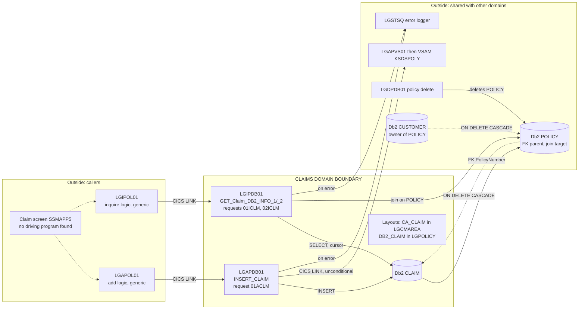
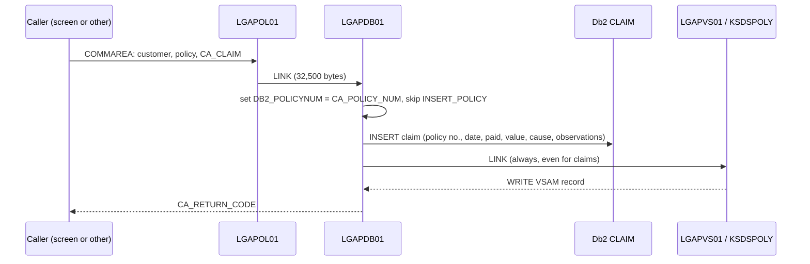

# GenApp PL/I — Claims Domain

**Related:** [Functional domains](genapp-functional-domains.md) · [Db2 table access matrix](db2-table-access-matrix.md) · [Program inventory](genapp-program-inventory.md)
**Basis:** static reading of source; nothing was executed.

Claims has **no programs of its own**. It is a set of claim branches inside the generic policy programs, plus one table (`CLAIM`) and one COMMAREA layout.

---

## 1. Boundary Diagram

---

## 2. Key Components

| Component | Role | Location |
|---|---|---|
| `LGAPDB01` `INSERT_CLAIM` | Inserts one `CLAIM` row. Skips `INSERT_POLICY` for claims | [`:538`](../../PLI%20Programs/LGAPDB01.pli:538), branch [`:174`](../../PLI%20Programs/LGAPDB01.pli:174), [`:195`](../../PLI%20Programs/LGAPDB01.pli:195), [`:219`](../../PLI%20Programs/LGAPDB01.pli:219) |
| `LGIPDB01` `GET_Claim_DB2_INFO_1` | Reads one claim by claim number (join with `POLICY`) | [`:1074`](../../PLI%20Programs/LGIPDB01.pli:1074) |
| `LGIPDB01` `GET_Claim_DB2_INFO_2` / `_2_Cur` | Reads claims for a customer through `CusClaim_Cursor` | [`:1156`](../../PLI%20Programs/LGIPDB01.pli:1156), [`:1183`](../../PLI%20Programs/LGIPDB01.pli:1183), cursor [`:150`](../../PLI%20Programs/LGIPDB01.pli:150) |
| `LGAPOL01`, `LGIPOL01` | Generic pass-through. No claim-specific logic | [`LGAPOL01.pli:133`](../../PLI%20Programs/LGAPOL01.pli:133), [`LGIPOL01.pli:91`](../../PLI%20Programs/LGIPOL01.pli:91) |
| Db2 `CLAIM` | `ClaimNumber` (identity, start 1000001), `PolicyNumber` FK, `ClaimDate`, `Paid`, `Value`, `Cause`, `Observations` | [`db2cre.jcl:353`](../../DDL/db2cre.jcl:353) |
| `CA_CLAIM` | COMMAREA layout for claims | [`LGCMAREA.inc:102`](../../Includes/LGCMAREA.inc:102) |
| `DB2_CLAIM`, `WS_CLAIM_LEN`, `WS_FULL_CLAIM_LEN` | Host structure and length constants (546 / 618) | [`LGPOLICY.inc:106`](../../Includes/LGPOLICY.inc:106), [`:19`](../../Includes/LGPOLICY.inc:19), [`:24`](../../Includes/LGPOLICY.inc:24) |
| BMS map `SSMAPP5` | "Claim Menu": 1 = Inquiry, 2 = Add; fields `ENP5LNO` (claim no.), `ENP5PNO`, `ENP5CNO`, `ENP5CDA`, `ENP5PAD`, `ENP5VAL`, `ENP5CAU`, `ENP5OBS` | [`SSMAP.bms:616`](../../Maps/SSMAP.bms:616) |

**Supported requests**

| Request ID | Handled by | Result |
|---|---|---|
| `01ACLM` | `LGAPDB01` | Insert claim |
| `01ICLM` | `LGIPDB01` | Read one claim by claim number |
| `02ICLM` | `LGIPDB01` | Read claims for a customer |
| `01UCLM`, `01DCLM` | No program | Not supported (see risk 5) |

---

## 3. Data Flows

### 3.1 Add claim (`01ACLM`)

Failure paths: any SQL failure sets return code `90`, writes the error message and issues `EXEC CICS ABEND ABCODE('LGSQ') NODUMP` ([`LGAPDB01.pli:567`](../../PLI%20Programs/LGAPDB01.pli:567)). A missing parent policy fails on the foreign key.

### 3.2 Inquire claim (`01ICLM`, `02ICLM`)
`LGIPOL01` → `LGIPDB01` → `SELECT … FROM POLICY, CLAIM`.
- **By claim number:** `WHERE CLAIM.ClaimNumber = :claimnum`. The customer number is not part of the filter ([`LGIPDB01.pli:1096`](../../PLI%20Programs/LGIPDB01.pli:1096)).
- **By customer:** `WHERE POLICY.CustomerNumber = :customer`, read through `CusClaim_Cursor`.
- Result: claim fields go into the COMMAREA through `DB2_CLAIM_TEXT`, and the end of data is marked `'FINAL'`.
- Return codes: `01` = no rows (SQLCODE 100), `90` = other SQL error, `98` = COMMAREA too small, `89` / `88` = cursor open / close failure.

### 3.3 Indirect flow: delete
No claim delete exists. Claims are removed only when the parent `POLICY` row is deleted by `LGDPDB01`, through `ON DELETE CASCADE` ([`db2cre.jcl:364`](../../DDL/db2cre.jcl:364)). Deleting a **customer** removes policies and then claims in the same way.

---

## 4. Shared Resources

| Resource | Shared with | Nature of sharing |
|---|---|---|
| Db2 `POLICY` | Policy add, update, delete, inquiry | FK parent of `CLAIM`; join target for both inquiry paths |
| `LGCMAREA` COMMAREA | Every program | `CA_CLAIM` overlays the same `CA_POLICY_SPECIFIC` area as the Endowment, House, Motor and Commercial layouts |
| `LGPOLICY` host structures | `*DB01`, `*OL01` | `DB2_CLAIM` is a union with the other policy types |
| `SQLCA`, DB2 plan and grants | All Db2 programs | Plan and `GRANT` statements in [`db2cre.jcl`](../../DDL/db2cre.jcl) |
| Tablespace `GENATS07` | `CLAIM` only | Holds the claim table |
| `LGSTSQ` error logger | All programs | Called from each program's `WRITE_ERROR_MESSAGE` |
| VSAM `KSDSPOLY` | Policy add, update, delete | Written for claims by accident of control flow (see risk 3) |

---

## 5. Dependencies on the Rest of the Application

| Direction | Dependency | Detail |
|---|---|---|
| **Inbound** | `LGAPOL01` → `LGAPDB01`; `LGIPOL01` → `LGIPDB01` | Claims depends on these generic programs for COMMAREA checks and error handling |
| **Inbound** | Front end | `SSMAPP5` exists, but no workspace program uses it. The CSD has no `SSP5` transaction (only `SSP1`–`SSP4`), and `LGTESTP2`–`4` source is not in the workspace |
| **Outbound** | `POLICY` | Required parent row. Without it, a claim insert fails on the FK |
| **Outbound** | `LGAPVS01` / `KSDSPOLY` | Called unconditionally by `LGAPDB01` after the claim insert |
| **Outbound** | `LGSTSQ` | Error logging |
| **Upstream** | `CUSTOMER` | Reached only through `POLICY`; customer data is not read by claim code |
| **Not present** | Underwriting rules (`LGAPBR01`) | Applies to `01AEND` only |

---

## 6. Risks Found in the Claim Paths

These come from reading the code. They have not been confirmed by running it.

1. **Claim number is never generated.** `INSERT_CLAIM` inserts `:DB2_C_Num_INT`, which is never assigned (it is zeroed at [`LGAPDB01.pli:127`](../../PLI%20Programs/LGAPDB01.pli:127)). `ClaimNumber` is `GENERATED BY DEFAULT`, so Db2 accepts the explicit `0`. The first claim would get number 0 and the second would fail with a duplicate key, which sets return code `90` and abends with `LGSQ`. The program also never calls `IDENTITY_VAL_LOCAL()`, so it returns `CA_C_Num = 0` to the caller.
2. **No length check for the claim data.** The `01ACLM` branch adds nothing to the required length, so only the 28-byte header is checked ([`LGAPDB01.pli:174`](../../PLI%20Programs/LGAPDB01.pli:174)).
3. **Claim add also writes the policy VSAM file.** `LGAPVS01` takes character 4 of the request ID as the record type. For `01ACLM` that is `C`, the same type as Commercial (`01ACOM`) ([`LGAPVS01.pli:84`](../../PLI%20Programs/LGAPVS01.pli:84)). It then builds the record from the **commercial** field names, which overlay claim text in the COMMAREA. A claim against a Commercial policy of the same customer would produce the same 21-byte key as the policy's existing record, so the write would fail with return code `80`.
4. **The multi-row inquiry returns only one claim.** Each fetch overwrites the same COMMAREA fields, so the caller sees only the last row ([`LGIPDB01.pli:1168`](../../PLI%20Programs/LGIPDB01.pli:1168)). The loop `DO UNTIL (SQLCODE > 0)` also does not stop on a negative SQLCODE, and `GET_ClaiM_DB2_INFO_2_Cur` has no error branch.
5. **Update and delete requests for claims are not cleanly blocked.** `LGDPOL01` returns `99` for `01DCLM`. `LGUPOL01` sets `99` for `01UCLM` but still goes on to call `LGUPDB01` ([`LGUPOL01.pli:128`](../../PLI%20Programs/LGUPOL01.pli:128)). What `LGUPDB01` then does with a claim request has not been traced.
6. **No ownership check on inquiry by claim number.** Any caller who knows a claim number can read it, whatever customer number is sent.
7. **Policy fields in a claim inquiry are unpopulated.** The claim `SELECT` does not fetch policy dates, broker or payment, yet the code copies those host variables into the COMMAREA ([`LGIPDB01.pli:1123`](../../PLI%20Programs/LGIPDB01.pli:1123)).

---

## 7. Change-Impact Summary

| If you change… | Also review |
|---|---|
| `CLAIM` table columns | `LGAPDB01` insert, both `LGIPDB01` queries and cursor, `DB2_CLAIM`, `CA_CLAIM`, `WS_CLAIM_LEN` and `WS_FULL_CLAIM_LEN`, `SSMAPP5` |
| `CA_CLAIM` layout | `LGCMAREA` consumers (all programs), `SSMAP.inc`, and the `LGAPVS01` field overlay (risk 3) |
| `POLICY` key or delete rule | The `CLAIM` foreign key and cascade behaviour |
| Request ID scheme | `LGAPVS01`, `LGUPVS01` and `LGDPVS01`, which use character 4 as the VSAM record type |
