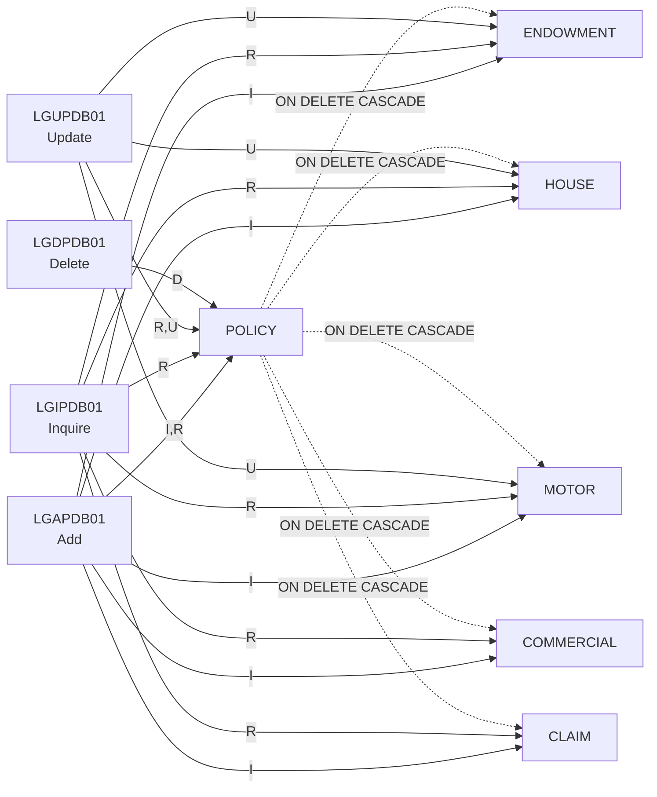

# GenApp PL/I — Db2 Table Access (CRUD) Matrix

**Scope:** All PL/I programs in [`PLI Programs/`](../../PLI%20Programs/) and all tables created in [`DDL/db2cre.jcl`](../../DDL/db2cre.jcl)
**Method:** Local scanner metadata DB query (SQLTables → StatementReference), checked against every `EXEC SQL` statement in the source
**Legend:** **R** = Read (SELECT / cursor FETCH) · **I** = Insert · **U** = Update · **D** = Delete · **(D)** = deleted indirectly by Db2 `ON DELETE CASCADE` · — = no access

---

## 1. Matrix

| Db2 Table | [`LGAPDB01`](../../PLI%20Programs/LGAPDB01.pli) (Add) | [`LGIPDB01`](../../PLI%20Programs/LGIPDB01.pli) (Inquire) | [`LGUPDB01`](../../PLI%20Programs/LGUPDB01.pli) (Update) | [`LGDPDB01`](../../PLI%20Programs/LGDPDB01.pli) (Delete) |
|---|:-:|:-:|:-:|:-:|
| `POLICY`          | **I, R** | **R** | **R, U** | **D** |
| `ENDOWMENT`       | **I**    | **R** | **U**    | (D) |
| `HOUSE`           | **I**    | **R** | **U**    | (D) |
| `MOTOR`           | **I**    | **R** | **U**    | (D) |
| `COMMERCIAL`      | **I**    | **R** | —        | (D) |
| `CLAIM`           | **I**    | **R** | —        | (D) |
| `CUSTOMER`        | —        | —     | —        | — |
| `CUSTOMER_SECURE` | —        | —     | —        | — |

Only these four PL/I programs contain `EXEC SQL`. None of the other PL/I programs access Db2 (`LGTESTP1`, `LGAPOL01`, `LGIPOL01`, `LGUPOL01`, `LGDPOL01`, `LGAPVS01`, `LGUPVS01`, `LGDPVS01`).

---

## 2. Statement-Level Evidence

### LGAPDB01 — Add Policy (Db2)
| Table | Op | Source |
|---|---|---|
| POLICY | INSERT | [`LGAPDB01.pli:250`](../../PLI%20Programs/LGAPDB01.pli:250) |
| POLICY | SELECT `LASTCHANGED` (read back the new timestamp) | [`LGAPDB01.pli:300`](../../PLI%20Programs/LGAPDB01.pli:300) |
| ENDOWMENT | INSERT (2 versions: with and without the VARCHAR padding) | [`LGAPDB01.pli:329`](../../PLI%20Programs/LGAPDB01.pli:329), [`:351`](../../PLI%20Programs/LGAPDB01.pli:351) |
| HOUSE | INSERT | [`LGAPDB01.pli:391`](../../PLI%20Programs/LGAPDB01.pli:391) |
| MOTOR | INSERT | [`LGAPDB01.pli:430`](../../PLI%20Programs/LGAPDB01.pli:430) |
| COMMERCIAL | INSERT | [`LGAPDB01.pli:479`](../../PLI%20Programs/LGAPDB01.pli:479) |
| CLAIM | INSERT | [`LGAPDB01.pli:545`](../../PLI%20Programs/LGAPDB01.pli:545) |

### LGIPDB01 — Inquire Policy (Db2)
Every query joins `POLICY` with one policy-type table.

| Table(s) | Op | Source |
|---|---|---|
| POLICY + ENDOWMENT | SELECT INTO | [`LGIPDB01.pli:375`](../../PLI%20Programs/LGIPDB01.pli:375) |
| POLICY + HOUSE | SELECT INTO | [`LGIPDB01.pli:492`](../../PLI%20Programs/LGIPDB01.pli:492) |
| POLICY + MOTOR | SELECT INTO | [`LGIPDB01.pli:592`](../../PLI%20Programs/LGIPDB01.pli:592) |
| POLICY + COMMERCIAL | SELECT INTO (2 variants) | [`LGIPDB01.pli:706`](../../PLI%20Programs/LGIPDB01.pli:706), [`:821`](../../PLI%20Programs/LGIPDB01.pli:821) |
| POLICY + COMMERCIAL | Cursor `Cust_Cursor` (by customer): OPEN/FETCH/CLOSE | declared at [`:90`](../../PLI%20Programs/LGIPDB01.pli:90), used at [`:893`](../../PLI%20Programs/LGIPDB01.pli:893)–[`:933`](../../PLI%20Programs/LGIPDB01.pli:933) |
| POLICY + COMMERCIAL | Cursor `Zip_Cursor` (by zip code): OPEN/FETCH/CLOSE | declared at [`:120`](../../PLI%20Programs/LGIPDB01.pli:120), used at [`:997`](../../PLI%20Programs/LGIPDB01.pli:997)–[`:1021`](../../PLI%20Programs/LGIPDB01.pli:1021) |
| POLICY + CLAIM | SELECT INTO | [`LGIPDB01.pli:1096`](../../PLI%20Programs/LGIPDB01.pli:1096) |
| POLICY + CLAIM | Cursor `CusClaim_Cursor`: OPEN/FETCH/CLOSE | declared at [`:150`](../../PLI%20Programs/LGIPDB01.pli:150), used at [`:1161`](../../PLI%20Programs/LGIPDB01.pli:1161)–[`:1186`](../../PLI%20Programs/LGIPDB01.pli:1186) |

### LGUPDB01 — Update Policy (Db2)
| Table | Op | Source |
|---|---|---|
| POLICY | Cursor `POLICY_CURSOR` declared `FOR UPDATE OF …` (locks the row), then OPEN/FETCH | [`LGUPDB01.pli:105`](../../PLI%20Programs/LGUPDB01.pli:105), [`:192`](../../PLI%20Programs/LGUPDB01.pli:192) |
| POLICY | UPDATE … `WHERE CURRENT OF POLICY_CURSOR` | [`LGUPDB01.pli:249`](../../PLI%20Programs/LGUPDB01.pli:249) |
| POLICY | SELECT `LASTCHANGED` (read back the new timestamp) | [`LGUPDB01.pli:258`](../../PLI%20Programs/LGUPDB01.pli:258) |
| ENDOWMENT | UPDATE (2 versions: with and without the VARCHAR padding), for `01UEND` | [`LGUPDB01.pli:331`](../../PLI%20Programs/LGUPDB01.pli:331), [`:345`](../../PLI%20Programs/LGUPDB01.pli:345) |
| HOUSE | UPDATE, for `01UHOU` | [`LGUPDB01.pli:379`](../../PLI%20Programs/LGUPDB01.pli:379) |
| MOTOR | UPDATE, for `01UMOT` | [`LGUPDB01.pli:413`](../../PLI%20Programs/LGUPDB01.pli:413) |

### LGDPDB01 — Delete Policy (Db2)
| Table | Op | Source |
|---|---|---|
| POLICY | DELETE by customer number + policy number | [`LGDPDB01.pli:149`](../../PLI%20Programs/LGDPDB01.pli:149) |

---

## 3. Notes and Caveats

1. **Cascade deletes.** `LGDPDB01` deletes only from `POLICY`. The DDL defines `ENDOWMENT`, `HOUSE`, `MOTOR`, `COMMERCIAL` and `CLAIM` with `FOREIGN KEY … REFERENCES policy ON DELETE CASCADE` ([`db2cre.jcl:207`](../../DDL/db2cre.jcl:207), [`:242`](../../DDL/db2cre.jcl:242), [`:280`](../../DDL/db2cre.jcl:280), [`:328`](../../DDL/db2cre.jcl:328), [`:364`](../../DDL/db2cre.jcl:364)). Db2 therefore deletes the child rows; the program never names those tables. The source comment at [`LGDPDB01.pli:142`](../../PLI%20Programs/LGDPDB01.pli:142) relies on this behaviour.
2. **Update gaps.** `LGUPDB01` has no update path for `COMMERCIAL` or `CLAIM`. Its request-ID routing handles only `01UEND`, `01UHOU` and `01UMOT` ([`LGUPDB01.pli:217`](../../PLI%20Programs/LGUPDB01.pli:217)).
3. **Unused tables.** No PL/I program in this workspace references `CUSTOMER` or `CUSTOMER_SECURE`. They are still parents of `POLICY` through `ON DELETE CASCADE` ([`db2cre.jcl:167`](../../DDL/db2cre.jcl:167)), so deleting a customer outside this code would also delete that customer's policies.
4. **Scanner metadata gap.** The local scanner DB lists `LGUPDB01` as COBOL (`ProgramTypeID=1`) and has no SQL table references for it. The `LGUPDB01` rows above come from manual source inspection. All other rows agree with the scanner output.
