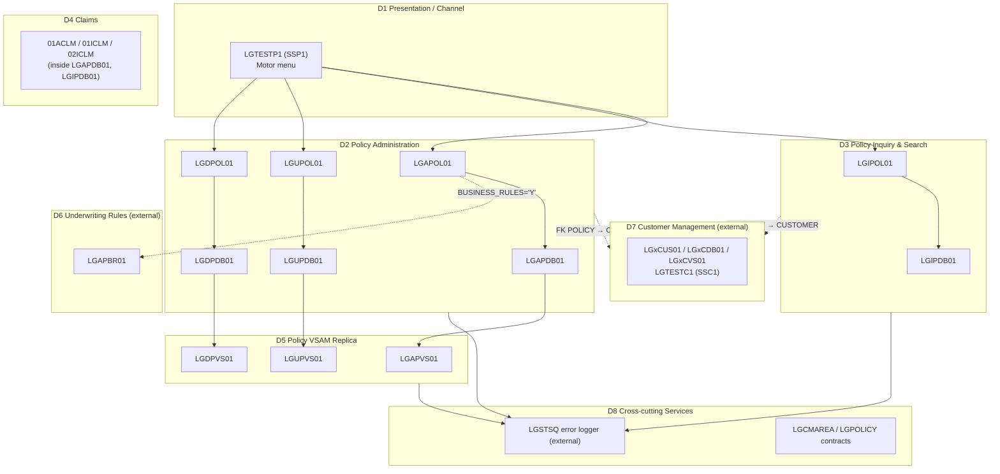

# GenApp PL/I — Functional Domains

**Sources:** [`PLI Programs/`](../../PLI%20Programs/), [`Includes/`](../../Includes/), [`DDL/db2cre.jcl`](../../DDL/db2cre.jcl), [`Maps/SSMAP.bms`](../../Maps/SSMAP.bms), [`Resources/DFHCSDUP.csd`](../../Resources/DFHCSDUP.csd), [`Resources/GenApp.CSD`](../../Resources/GenApp.CSD)
**Related:** [Program inventory](genapp-program-inventory.md) · [Db2 table access matrix](db2-table-access-matrix.md)

The application is a CICS/Db2 insurance system. The workspace holds 12 PL/I programs. The CSD defines more programs than that: the Customer domain and the non-Motor front ends are defined but their source is not here. Domains whose source is not in the workspace are marked **(external)**.

---

## 1. Domain Map

---

## 2. Domain Summaries

### D1 — Presentation / Channel
| Aspect | Detail |
|---|---|
| **Business responsibility** | Lets an agent or operator inquire, add, delete and update **Motor** policies from a 3270 terminal |
| **Main programs** | [`LGTESTP1`](../../PLI%20Programs/LGTESTP1.pli) (transaction `SSP1`). Menu options 1–4 map to `01IMOT`, `01AMOT`, `01DMOT`, `01UMOT` ([`LGTESTP1.pli:53`](../../PLI%20Programs/LGTESTP1.pli:53)) |
| **Data stores** | None directly. BMS mapset `SSMAP`, map `SSMAPP1` ([`SSMAP.bms:122`](../../Maps/SSMAP.bms:122)) |
| **Key dependencies** | LINKs to `LGIPOL01`, `LGAPOL01`, `LGDPOL01`, `LGUPOL01` with a 32,500-byte COMMAREA. Uses includes `LGCMAREA` and `SSMAP` |
| **Notes** | The CSD defines more front ends: `SSP2/3/4` → `LGTESTP2/3/4` and `SSC1` → `LGTESTC1`. Their maps exist (`SSMAPP2`–`SSMAPP5`, `SSMAPC1`), but their source is **not in the workspace** |

### D2 — Policy Administration (Add, Update, Delete)
| Aspect | Detail |
|---|---|
| **Business responsibility** | Policy lifecycle for the Endowment, House, Motor and Commercial products: issuing new policies, servicing existing ones, and cancelling them. Includes optimistic-concurrency control on updates (the `LASTCHANGED` timestamp comparison) |
| **Main programs** | Business logic: [`LGAPOL01`](../../PLI%20Programs/LGAPOL01.pli), [`LGUPOL01`](../../PLI%20Programs/LGUPOL01.pli), [`LGDPOL01`](../../PLI%20Programs/LGDPOL01.pli). Db2 access: [`LGAPDB01`](../../PLI%20Programs/LGAPDB01.pli), [`LGUPDB01`](../../PLI%20Programs/LGUPDB01.pli), [`LGDPDB01`](../../PLI%20Programs/LGDPDB01.pli) |
| **Data stores** | Db2 `POLICY` (I/R/U/D), `ENDOWMENT`, `HOUSE`, `MOTOR` (I/U), `COMMERCIAL` (I). Child rows are deleted by cascade |
| **Key dependencies** | Triggers D5 (VSAM replica) from each `*DB01` program. Optionally calls D6 on Endowment add. Logs errors through D8 `LGSTSQ`. Each `POLICY` row needs an existing `CUSTOMER` row (D7) |
| **Gaps** | Update supports only `01UEND`, `01UHOU` and `01UMOT`; there is no Commercial update ([`LGUPOL01.pli:103`](../../PLI%20Programs/LGUPOL01.pli:103)). Delete supports `01DEND`, `01DHOU`, `01DCOM` and `01DMOT` |

### D3 — Policy Inquiry & Search
| Aspect | Detail |
|---|---|
| **Business responsibility** | Retrieves a single policy by customer and policy number for each product. Also supports Commercial searches by policy number, by customer (`03ICOM`) and by zip code (`05ICOM`) |
| **Main programs** | [`LGIPOL01`](../../PLI%20Programs/LGIPOL01.pli) → [`LGIPDB01`](../../PLI%20Programs/LGIPDB01.pli). Routing is at [`LGIPDB01.pli:284`](../../PLI%20Programs/LGIPDB01.pli:284) |
| **Data stores** | Db2 `POLICY` joined to `ENDOWMENT`, `HOUSE`, `MOTOR`, `COMMERCIAL` or `CLAIM` (read only). Scroll cursors `Cust_Cursor`, `Zip_Cursor` and `CusClaim_Cursor` |
| **Key dependencies** | Called by D1. Logs errors through D8. Uses the result-length constants in `LGPOLICY` |
| **Notes** | `LGIPOL01` does **not** read VSAM. A separate VSAM inquiry, `LGIPVS01` (transaction `LGPF`), is defined in the CSD but its source is not in the workspace |

### D4 — Claims
| Aspect | Detail |
|---|---|
| **Business responsibility** | Records claims against a policy and retrieves claims by claim number or for all of a customer's policies |
| **Main programs** | No dedicated programs. Claims logic is embedded in the policy programs: `01ACLM` in `LGAPDB01` ([`:219`](../../PLI%20Programs/LGAPDB01.pli:219)), and `01ICLM`/`02ICLM` in `LGIPDB01` ([`:314`](../../PLI%20Programs/LGIPDB01.pli:314)) |
| **Data stores** | Db2 `CLAIM` (I/R). Its foreign key to `POLICY` uses `ON DELETE CASCADE` |
| **Key dependencies** | Fully dependent on D2/D3 for program flow and on `POLICY` for referential integrity |
| **Gaps** | No claim update or delete path. No front end in the workspace drives claim requests |

### D5 — Policy VSAM Replica
| Aspect | Detail |
|---|---|
| **Business responsibility** | Keeps a lightweight VSAM summary of each policy alongside Db2. It is meant for fast lookups by other consumers, such as `LGIPVS01`/`LGPF` |
| **Main programs** | [`LGAPVS01`](../../PLI%20Programs/LGAPVS01.pli) (WRITE), [`LGUPVS01`](../../PLI%20Programs/LGUPVS01.pli) (READ UPDATE + REWRITE), [`LGDPVS01`](../../PLI%20Programs/LGDPVS01.pli) (DELETE) |
| **Data stores** | VSAM KSDS `KSDSPOLY` (`ADAPPL.GENAPP.KSDSPOLY`, 64-byte records, 21-byte key = policy-type letter + customer number + policy number) ([`GenApp.CSD:85`](../../Resources/GenApp.CSD:85), [`LGAPVS01.pli:21`](../../PLI%20Programs/LGAPVS01.pli:21)) |
| **Key dependencies** | Called only by the D2 `*DB01` programs, after their Db2 work. Logs errors through D8 |
| **Risk** | The replica must stay in step with Db2 inside one CICS unit of work. If a VSAM write fails after Db2 has succeeded, both rely on transaction backout. Also, `LGUPDB01` passes only `LENGTH(225)` of the COMMAREA to `LGUPVS01` ([`LGUPDB01.pli:157`](../../PLI%20Programs/LGUPDB01.pli:157)) |

### D6 — Underwriting Business Rules (external)
| Aspect | Detail |
|---|---|
| **Business responsibility** | Applies ODM business rules to new Endowment policies |
| **Main programs** | `LGAPBR01`. It is defined in the CSD but its source is not in the workspace |
| **Data stores** | Unknown (source not available) |
| **Key dependencies** | Called by `LGAPOL01` only when `BUSINESS_RULES = 'Y'` and the request is `01AEND` ([`LGAPOL01.pli:122`](../../PLI%20Programs/LGAPOL01.pli:122)). The switch is off by default |

### D7 — Customer Management (external)
| Aspect | Detail |
|---|---|
| **Business responsibility** | Customer onboarding, inquiry, maintenance and credential security. Customer is the parent entity of every policy |
| **Main programs** | All defined in the CSD, none in the workspace: `LGACUS01`, `LGICUS01`, `LGUCUS01`, `LGACDB01`, `LGACDB02`, `LGICDB01`, `LGUCDB01`, `LGACVS01`, `LGICVS01` (`LGCF`), `LGUCVS01`, `LGTESTC1` (`SSC1`) |
| **Data stores** | Db2 `CUSTOMER` and `CUSTOMER_SECURE`. VSAM `KSDSCUST` (`ADAPPL.GENAPP.KSDSCUST`, 10-byte key) |
| **Key dependencies** | Shares the COMMAREA through `CA_CUSTOMER_REQUEST` and `CA_CUSTSECR_REQUEST` ([`LGCMAREA.inc:20`](../../Includes/LGCMAREA.inc:20)). `POLICY.customerNumber` references `CUSTOMER` with `ON DELETE CASCADE` ([`db2cre.jcl:167`](../../DDL/db2cre.jcl:167)), so deleting a customer deletes all of that customer's policies and claims |

### D8 — Cross-cutting Services
| Aspect | Detail |
|---|---|
| **Business responsibility** | Error logging, shared data contracts and environment setup |
| **Components** | **Error logging:** `LGSTSQ` (external). Every program LINKs to it from its `WRITE_ERROR_MESSAGE` procedure with date, time, customer, policy and SQLCODE, plus up to 90 bytes of COMMAREA ([`LGAPDB01.pli:582`](../../PLI%20Programs/LGAPDB01.pli:582)). **Contracts:** [`LGCMAREA.inc`](../../Includes/LGCMAREA.inc) (32,500-byte COMMAREA) and [`LGPOLICY.inc`](../../Includes/LGPOLICY.inc) (Db2 host structures and lengths). **Setup:** `LGSETUP` (transaction `LGSE`, external) |
| **Data stores** | CICS queues written by `LGSTSQ` |
| **Key dependencies** | Every domain depends on these. A change to `LGCMAREA` affects every program in D1–D7 |

---

## 3. Domain × Data Store Summary

| Data store | D2 Policy Admin | D3 Inquiry | D4 Claims | D5 VSAM Replica | D7 Customer (ext) |
|---|:-:|:-:|:-:|:-:|:-:|
| Db2 `POLICY` | I R U D | R | R (join) | — | (cascade parent) |
| Db2 `ENDOWMENT` / `HOUSE` / `MOTOR` | I U | R | — | — | — |
| Db2 `COMMERCIAL` | I | R | — | — | — |
| Db2 `CLAIM` | — | — | I R | — | — |
| Db2 `CUSTOMER`, `CUSTOMER_SECURE` | — | — | — | — | owner |
| VSAM `KSDSPOLY` | — | — | — | W, RU, D | — |
| VSAM `KSDSCUST` | — | — | — | — | owner |

---

## 4. Architectural Observations

1. **Policy domains are organised by operation, not by product.** Each program handles all products and branches on `CA_REQUEST_ID`. Adding a product therefore touches every `*OL01`, `*DB01` and `*VS01` program, plus `LGCMAREA`.
2. **Claims has no domain boundary of its own.** It lives inside the policy programs and has no dedicated service, update or delete path.
3. **There are two persistence copies of policy data** (Db2 and `KSDSPOLY`). Synchronisation depends entirely on the CICS unit of work.
4. **About half of the defined application is not in this workspace:** the Customer domain, the other front ends, `LGAPBR01`, `LGSTSQ`, `LGSETUP` and `LGIPVS01`. A full impact analysis needs that source.
