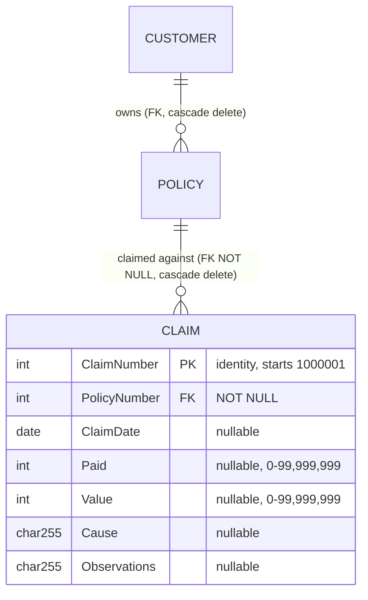

# Claims Domain: Business Rules to Preserve on Migration

**Scope:** Business-level validations, constraints, entity relationships and outcomes for Claims in GenApp-PLI.
**Starting point:** [`LGAPDB01.md`](../../program/PLI%20Programs/LGAPDB01.md), checked against the source. The program doc is not always accurate for Claims, so each rule below was checked against the code. Where the source differs from the doc, the difference is noted (see section 5).
**Excluded:** COMMAREA plumbing, return-code mechanics, TDQ logging (`WRITE_ERROR_MESSAGE`), request routing and CICS abends, except where they enforce a business constraint.

---

## 1. Claim entity and its relationship to Policy

Source: [`db2cre.jcl:353-367`](../../../DDL/db2cre.jcl:353), [`LGCMAREA.inc:102-109`](../../../Includes/LGCMAREA.inc:102).

- A Claim has no customer link of its own. The customer is reached only through `CLAIM.PolicyNumber → POLICY.CustomerNumber`.
- A Claim is not a Policy. It has no POLICY row and no policy-type row. The `'X'` policy-type code set for a claim request ([`LGAPDB01.pli:174-176`](../../../PLI%20Programs/LGAPDB01.pli:174)) is never persisted.

---

## 2. Business rules

| ID | Rule | Where implemented | Policy-domain dependency |
|---|---|---|---|
| **CLM-01** | **A claim must belong to exactly one policy.** `PolicyNumber` is NOT NULL and is a foreign key to POLICY. | DDL [`db2cre.jcl:356,363-364`](../../../DDL/db2cre.jcl:356). Policy number taken from the caller at [`LGAPDB01.pli:146`](../../../PLI%20Programs/LGAPDB01.pli:146) and inserted at [`:557`](../../../PLI%20Programs/LGAPDB01.pli:557) (`:DB2_C_Policynum_INT`). | **Direct.** The policy must already exist. Claims are only ever attached to an existing policy and never create one. |
| **CLM-02** | **A claim cannot be registered against a non-existent policy.** The insert is rejected and nothing is stored. | Enforced only by the DB2 FK. `INSERT_CLAIM` treats any non-zero SQLCODE (including -530) the same way: RC `90` plus unit-of-work backout, with no distinct "policy not found" outcome ([`LGAPDB01.pli:567-573`](../../../PLI%20Programs/LGAPDB01.pli:567)). | **Direct.** The rule depends on the Policy store. The migrated system must keep this check and should return a distinct "policy not found" error. |
| **CLM-03** | **Claims do not create or modify policy data.** The POLICY header insert is skipped for claim requests. | [`LGAPDB01.pli:195-197`](../../../PLI%20Programs/LGAPDB01.pli:195) (`If CA_REQUEST_ID <> '01ACLM'`). | Policy is read-only for the claim flow. |
| **CLM-04** | **Claim data captured:** claim date, amount paid, claim value (assessed), cause, observations. | Insert at [`LGAPDB01.pli:544-563`](../../../PLI%20Programs/LGAPDB01.pli:544). Field definitions in [`LGCMAREA.inc:103-108`](../../../Includes/LGCMAREA.inc:103). | None. |
| **CLM-05** | **Amounts are whole-unit, unsigned, at most 8 digits.** `Paid` and `Value` are `PIC '99999999'` (0 to 99,999,999) stored as INTEGER. No decimals and no negative values (no reversals or refunds). | [`LGCMAREA.inc:105-106`](../../../Includes/LGCMAREA.inc:105); conversion at [`LGAPDB01.pli:540-541`](../../../PLI%20Programs/LGAPDB01.pli:540). | None. Currency and precision are an open question (see 4). |
| **CLM-06** | **Text limits:** Cause and Observations are each limited to 255 chars. | [`LGCMAREA.inc:107-108`](../../../Includes/LGCMAREA.inc:107); DDL `Char(255)` [`:360-361`](../../../DDL/db2cre.jcl:360). | None. |
| **CLM-07** | **Claim number is a system-assigned unique identifier.** The DDL defines it as an identity starting at 1,000,001 and incrementing by 1. It is the primary key. | DDL [`db2cre.jcl:354-355,362`](../../../DDL/db2cre.jcl:354). **See defect D-1 in section 5. The program does not use the identity.** | None. |
| **CLM-08** | **Registration is all-or-nothing.** If the claim insert fails, the unit of work is rolled back. | `EXEC CICS ABEND ABCODE('LGSQ')` at [`LGAPDB01.pli:571`](../../../PLI%20Programs/LGAPDB01.pli:571). | For claims there is no preceding POLICY write to undo. For policy types the same abend rolls back the POLICY row. The migrated system needs equivalent transactionality. |
| **CLM-09** | **Retrieve one claim by claim number.** Returns customer, claim, policy, date, paid, value, cause and observations. "Not found" is a distinct outcome (RC `01`). | `GET_CLAIM_DB2_INFO_1`, [`LGIPDB01.pli:1074-1150`](../../../PLI%20Programs/LGIPDB01.pli:1074); dispatch `01ICLM` at [`:314-317`](../../../PLI%20Programs/LGIPDB01.pli:314). | **Direct.** The claim is joined to POLICY (`POLICY.POLICYNUMBER = CLAIM.POLICYNUMBER`). This is how the owning customer is derived. |
| **CLM-10** | **Retrieve claims by customer.** Claims are found via Customer → Policy → Claim. A customer's claims are the claims on all of that customer's policies. | Cursor `CusClaim_Cursor`, [`LGIPDB01.pli:149-164`](../../../PLI%20Programs/LGIPDB01.pli:149); `GET_CLAIM_DB2_INFO_2`, [`:1156-1215`](../../../PLI%20Programs/LGIPDB01.pli:1156). | **Direct.** The customer-to-claim relationship exists only through Policy. See defect D-3. |
| **CLM-11** | **Claims are immutable once registered.** There is no update-claim or delete-claim operation (`01UCLM` and `01DCLM` do not exist). Only add and inquire (`01ACLM`, `01ICLM`, `02ICLM`) are supported. | Absence in [`LGUPDB01.pli`](../../../PLI%20Programs/LGUPDB01.pli) (no claim logic) and [`LGDPDB01.pli:123`](../../../PLI%20Programs/LGDPDB01.pli:123) (only `01DEND/HOU/COM/MOT`). | None. Paid and Value cannot be amended after registration. Settlement progress is not modelled. |
| **CLM-12** | **Claims are deleted with their policy.** Deleting a policy removes all its claims. Deleting a customer cascades to policies and then to claims. | `ON DELETE CASCADE`, [`db2cre.jcl:365`](../../../DDL/db2cre.jcl:365); policy delete at [`LGDPDB01.pli:145-162`](../../../PLI%20Programs/LGDPDB01.pli:145) with the comment "delete should be propagated" at [`:142`](../../../PLI%20Programs/LGDPDB01.pli:142). | **Direct.** Claim lifecycle is owned by Policy. There is no archival or retention of claim history. |
| **CLM-13** | **Business outcome of a successful add:** the claim is stored against the policy and the caller receives success (`00`). The intent is to return the claim number (see D-1). | [`LGAPDB01.pli:565`](../../../PLI%20Programs/LGAPDB01.pli:565). | Policy number is echoed unchanged. |

---

## 3. Rules the legacy code does not enforce

The legacy system does not enforce the following. If the business expects them, they are new requirements for the target system. If the business does not, the target must not add them silently, or behaviour will change.

| ID | Not enforced | Evidence |
|---|---|---|
| **GAP-1** | **Policy active or in force** at the claim date. No check against `ISSUEDATE` / `EXPIRYDATE`. | `INSERT_CLAIM` uses only the policy number. |
| **GAP-2** | **Claim date must lie within the policy period**, and must not be in the future. | No date logic. `ClaimDate` is nullable. |
| **GAP-3** | **Policy-to-customer ownership.** `CA_CUSTOMER_NUM` is not used in the claim insert, so a claim can be registered against any policy number without checking it belongs to the stated customer. | [`LGAPDB01.pli:195-221`](../../../PLI%20Programs/LGAPDB01.pli:195); the insert at [`:556-562`](../../../PLI%20Programs/LGAPDB01.pli:556) has no customer predicate. |
| **GAP-4** | **`Paid` ≤ `Value`**, and `Paid` ≤ policy cover (sum assured, house or motor value). | No comparison anywhere. |
| **GAP-5** | **Mandatory fields.** Date, Paid, Value, Cause and Observations are all nullable. | DDL [`db2cre.jcl:357-361`](../../../DDL/db2cre.jcl:357). |
| **GAP-6** | **Duplicate or multiple claims** for the same incident or policy. There is no uniqueness other than the claim number. | DDL primary key only. |
| **GAP-7** | **Claim type vs policy type.** Claims are not validated against the policy type (E, H, M or C). | No type lookup. |
| **GAP-8** | **Claim status or lifecycle.** There is no open/closed/rejected state, unlike COMMERCIAL, which has `Status` and `RejectionReason`. | No such columns in CLAIM. |

---

## 4. Open business questions raised by the above

1. Should claims be blocked on expired or unpaid policies (GAP-1, GAP-2)?
2. Should the claim be tied to a customer-supplied identity check (GAP-3)?
3. Is `Paid > Value` a legitimate case, for example a goodwill payment (GAP-4)?
4. Should claim history survive policy cancellation or deletion (CLM-12)? Cascade delete conflicts with typical insurance record-retention requirements.
5. What currency and decimal precision apply to `Paid` and `Value` (CLM-05)?

---

## 5. Defects and anomalies found in the legacy code

These need a decision. Do not migrate them blindly. The first four affect the business rules above.

| ID | Finding | Evidence | Effect |
|---|---|---|---|
| **D-1** | **The claim number is never assigned, so it is always 0.** `DB2_C_Num_INT` is zero-initialised with `DB2_IN_INTEGERS = 0` ([`:127`](../../../PLI%20Programs/LGAPDB01.pli:127)). It is never set from `CA_C_Num`, and it is supplied explicitly in the INSERT ([`:556`](../../../PLI%20Programs/LGAPDB01.pli:556)). Because the identity is `GENERATED BY DEFAULT`, the explicit value `0` overrides generation. The same zero is then copied back to `CA_C_Num` ([`:565`](../../../PLI%20Programs/LGAPDB01.pli:565)). | [`LGAPDB01.pli:101,127,556,565`](../../../PLI%20Programs/LGAPDB01.pli:556); DDL [`:354`](../../../DDL/db2cre.jcl:354) | On this reading, the first claim would be stored as claim 0 and a second would fail the primary key with RC `90`. The program doc ([`LGAPDB01.md:113,142`](../../program/PLI%20Programs/LGAPDB01.md)) says the claim number is used as the key and returned to the caller. **That is not what the code does.** Confirm in the live system. The target should generate the claim number (CLM-07) and return it. |
| **D-2** | **"Policy not found" cannot be told apart from other failures.** SQLCODE -530 is reported as RC `70` for policy inserts but as RC `90` for claims. | [`:567-573`](../../../PLI%20Programs/LGAPDB01.pli:567) vs the policy path | See CLM-02. |
| **D-3** | **The "all claims for a customer" inquiry (`02ICLM`) returns only the last claim.** Each fetch overwrites the same output fields, there is no length check, and nothing accumulates. | [`LGIPDB01.pli:1168-1170,1197-1212`](../../../PLI%20Programs/LGIPDB01.pli:1168) | The business intent (CLM-10) is a list. The legacy behaviour is effectively "most recent row". |
| **D-4** | **Minimum input length is not enforced for Claim adds.** Required length for `01ACLM` is the 28-byte header only. Endowment, house and motor add `WS_FULL_*_LEN`, but claim adds nothing, although the claim structure needs `WS_FULL_CLAIM_LEN` = 618 ([`LGPOLICY.inc:24`](../../../Includes/LGPOLICY.inc:24)). The inquiry path does enforce it ([`LGIPDB01.pli:1107`](../../../PLI%20Programs/LGIPDB01.pli:1107)). | [`LGAPDB01.pli:151-189`](../../../PLI%20Programs/LGAPDB01.pli:151) | A truncated request can be accepted and read past the supplied data. In the target, treat the claim payload as fully required. |
| **D-5** | **Claim adds also write a VSAM policy-index record.** `LGAPDB01` links to `LGAPVS01` unconditionally ([`:229-231`](../../../PLI%20Programs/LGAPDB01.pli:229)). `LGAPVS01` keys on character 4 of the request ID ([`LGAPVS01.pli:84`](../../../PLI%20Programs/LGAPVS01.pli:84)). For `01ACLM` that character is `'C'`, the same as `01ACOM` (commercial), so the claim is written as a commercial-style KSDS record keyed by customer and policy number ([`:88-94,126-131`](../../../PLI%20Programs/LGAPVS01.pli:88)). | Source as cited | This looks like a side-effect. It may collide with the policy's own record (duplicate key gives RC `80`, with the DB2 claim already stored) and fills commercial fields from claim data. The VSAM index is an implementation concern. Do not carry it into the target unless another consumer depends on it. |
| **D-6** | **The claim inquiry's returned policy header fields are not populated.** `ISSUEDATE`, `EXPIRYDATE`, `BROKERID` and similar are copied to the output but are not selected by the claim queries. | [`LGIPDB01.pli:1123-1128`](../../../PLI%20Programs/LGIPDB01.pli:1123) vs SELECT at [`:1078-1100`](../../../PLI%20Programs/LGIPDB01.pli:1078) | Consumers cannot rely on policy dates or broker details in the claim response. |

---

## 6. Dependencies on the Policy domain

| Policy-domain element | Used by Claims for | Migration implication |
|---|---|---|
| `POLICY.POLICYNUMBER` (PK) | The claim FK (CLM-01, CLM-02). | The target Claims service needs a policy lookup or reference. A shared database FK, a service call, or a replicated policy-ID cache would all work. |
| `POLICY.CUSTOMERNUMBER` | The only route from Claim to Customer (CLM-09, CLM-10). | Claims by customer need a join through Policy or a replicated customer-to-policy map. |
| Policy delete (`LGDPDB01`) | Cascade removal of claims (CLM-12). | Claim retention and cascade behaviour must be explicitly decided and kept consistent when Policy is migrated separately. |
| Policy add (`LGAPDB01`/`LGAPOL01`) | Claims share the add program and its entry flow, but not its data or rules. They are routed by `CA_REQUEST_ID = '01ACLM'` and skip the POLICY insert (CLM-03). | Claims logic is entangled with Policy add in one program. Separate it on migration. |
| Policy types (E/H/M/C) | Not used (GAP-7). | No coupling today. |
| Policy dates, status, sum assured | Not used (GAP-1, GAP-2, GAP-4). | No coupling today. Any new rule here would add a Policy dependency. |

---

## 7. Summary for the migration team

**Preserve:**
- CLM-01 and CLM-02: claim to exactly one existing policy.
- CLM-03: claims never create or modify policies.
- CLM-04 to CLM-06: field set and limits.
- CLM-07: system-generated unique claim number (intended behaviour).
- CLM-08: transactional add.
- CLM-09 and CLM-10: lookup by claim number and by customer through policy.
- CLM-11: claims cannot be amended or deleted individually.
- CLM-12: claims are removed with their policy (or replace this deliberately with a retention rule).

**Decide:**
- GAP-1 to GAP-8, and the open questions in section 4.

**Fix or do not carry over:**
- D-1 to D-6.
