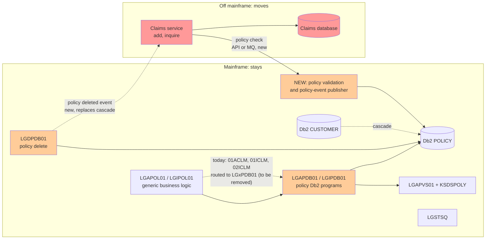
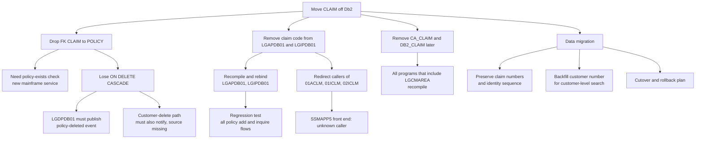

# Impact Analysis Report: Move the Claims Domain Off the Mainframe

**Created**: 2026-10-12T21:22:26Z
**Author**: IBM Bob (Z Architect mode)
**Analysis Method**: Local Workspace (scanner database via SQL, plus direct source review). Z Understand was offered and declined.
**Workspace Alignment**: Not Applicable (local only)
**Confidence Level**: Medium. See [section 8](#8-assumptions-unknowns-and-confidence).

Related: [Claims domain](../../architecture/claims-domain.md) · [Functional domains](../../architecture/genapp-functional-domains.md) · [Db2 table access matrix](../../architecture/db2-table-access-matrix.md)

---

## 1. Change Summary

| Item | Detail |
|---|---|
| **Title** | Relocate the Claims domain off the mainframe; the rest of GenApp keeps running on CICS/Db2 |
| **Type** | Migration |
| **Target design (confirmed by user)** | Claims becomes a separate service with **its own database**. It validates policies by calling a **policy API or MQ service on the mainframe**. The Db2 foreign key `CLAIM → POLICY` is replaced by an application-level check |
| **Key technologies** | PL/I, CICS (LINK, COMMAREA), Db2 for z/OS, VSAM, BMS |
| **Claims entry points today** | `LGAPDB01` (`01ACLM`), `LGIPDB01` (`01ICLM`, `02ICLM`) |

**Headline finding.** Claims code is small, but it sits inside programs shared with every other policy type. The hard part is not moving the `CLAIM` table. It is replacing three things that the mainframe gives claims for free today:
1. the foreign key to `POLICY`,
2. the cascade delete when a policy is removed, and
3. the join to `POLICY` that links customers to claims.

None of the three has a replacement in the code today. There is also no policy-existence service and no MQ in the workspace.

---

## 2. Scope Definition

### In scope (changes or goes away)
| Component | Why |
|---|---|
| Db2 `CLAIM` table, index `iClaim`, tablespace `GENATS07` | Data moves to the new database ([`db2cre.jcl:353`](../../../DDL/db2cre.jcl:353)) |
| `LGAPDB01` claim branches and `INSERT_CLAIM` | Claim add moves out ([`:174`](../../../PLI%20Programs/LGAPDB01.pli:174), [`:195`](../../../PLI%20Programs/LGAPDB01.pli:195), [`:219`](../../../PLI%20Programs/LGAPDB01.pli:219), [`:538`](../../../PLI%20Programs/LGAPDB01.pli:538)) |
| `LGIPDB01` claim branches, `CusClaim_Cursor`, `GET_Claim_*` | Claim inquiry moves out ([`:150`](../../../PLI%20Programs/LGIPDB01.pli:150), [`:314`](../../../PLI%20Programs/LGIPDB01.pli:314), [`:1074`](../../../PLI%20Programs/LGIPDB01.pli:1074), [`:1156`](../../../PLI%20Programs/LGIPDB01.pli:1156)) |
| `CA_CLAIM`, `DB2_CLAIM`, `WS_CLAIM_LEN`, `WS_FULL_CLAIM_LEN` | Layouts and constants ([`LGCMAREA.inc:102`](../../../Includes/LGCMAREA.inc:102), [`LGPOLICY.inc:19`](../../../Includes/LGPOLICY.inc:19), [`:24`](../../../Includes/LGPOLICY.inc:24), [`:106`](../../../Includes/LGPOLICY.inc:106)) |
| BMS map `SSMAPP5` | Claim screen ([`SSMAP.bms:616`](../../../Maps/SSMAP.bms:616)) |

### New work on the mainframe side (not in scope today, required by the design)
| Item | Why |
|---|---|
| Policy validation service (CICS program plus API or MQ exposure) | The new claims service must confirm a policy exists and who owns it |
| Policy-change notification (at least policy delete) | Replaces the cascade delete |

### Out of scope but impacted
`POLICY`, `CUSTOMER`, `LGDPDB01`, `LGAPVS01`, `KSDSPOLY`, `LGSTSQ`, the CICS plan and bind, and the Db2 DDL job.

### System boundaries
- **External systems**: new Claims service and database, and the policy API or MQ channel between them.
- **Data boundary**: `CLAIM` is the only table that leaves. Its only link to the rest is `PolicyNumber`.

---

## 3. System Overview

**Legend:** red = moves or is new for Claims; orange = changes on the mainframe.

---

## 4. Dependencies Crossing the Claims Boundary

The scanner database was used to confirm CALL and table relationships. It shows that the only cross-program calls that touch claims are the generic `LGAPDB01 → LGAPVS01` and `* → LGSTSQ`. It records no CLAIM access for `LGUPDB01`, which is a scanner gap (see the [table matrix](../../architecture/db2-table-access-matrix.md)), but the source shows `LGUPDB01` has no claim logic.

### 4.1 Mainframe → Claims (rest depends on Claims)
| # | Dependency | Evidence | Effect when Claims leaves |
|---|---|---|---|
| D1 | **Cascade delete.** Deleting a `POLICY` row (by `LGDPDB01`) deletes its claims | [`LGDPDB01.pli:149`](../../../PLI%20Programs/LGDPDB01.pli:149), [`db2cre.jcl:364`](../../../DDL/db2cre.jcl:364) | Claims are no longer deleted. They become orphans in the new database |
| D2 | **Customer delete cascade** (policies, then claims). The customer programs are not in the workspace | [`db2cre.jcl:167`](../../../DDL/db2cre.jcl:167) | Same orphaning, through a path I cannot read |
| D3 | **Shared programs.** `LGAPDB01` and `LGIPDB01` serve all policy types, and claims is one branch of each | `WHEN ('01ACLM')`, `'01ICLM'`, `'02ICLM'` | Removing the branches means recompiling, rebinding and regression-testing the core add and inquire flows |
| D4 | **Shared Db2 plan and DBRMs** | `INSERT INTO CLAIM` and the `CusClaim_Cursor` are bound with those programs | Rebind needed. Until it is done, the plan still references `CLAIM` |
| D5 | **Shared DDL job.** One job creates `CLAIM` and grants on it | [`db2cre.jcl:353`](../../../DDL/db2cre.jcl:353), [`:400`](../../../DDL/db2cre.jcl:400) | Split the job. Drop the table only after cutover |

### 4.2 Claims → Mainframe (Claims depends on the rest)
| # | Dependency | Evidence | Replacement needed |
|---|---|---|---|
| D6 | **Foreign key `CLAIM.PolicyNumber → POLICY`.** Db2 rejects claims for unknown policies | [`db2cre.jcl:363`](../../../DDL/db2cre.jcl:363) | Policy check in the claims service (per your design) |
| D7 | **Join to `POLICY` for customer lookup.** `CusClaim_Cursor` finds a customer's claims by joining through `POLICY.CustomerNumber` | [`LGIPDB01.pli:160`](../../../PLI%20Programs/LGIPDB01.pli:160) | The new database needs the customer number, or a call to the mainframe |
| D8 | **Join to `POLICY` for claim-by-number.** `GET_Claim_DB2_INFO_1` joins `POLICY` to return the owning customer | [`LGIPDB01.pli:1096`](../../../PLI%20Programs/LGIPDB01.pli:1096) | Store customer number with the claim |
| D9 | **`LGAPVS01` / `KSDSPOLY`.** Claim add currently links to the VSAM writer too | [`LGAPDB01.pli:229`](../../../PLI%20Programs/LGAPDB01.pli:229) | None. The write is a side effect of shared code (see risk R12) |
| D10 | **Error logger `LGSTSQ`.** Both claim paths log through it | [`LGAPDB01.pli:595`](../../../PLI%20Programs/LGAPDB01.pli:595) | New logging and monitoring in the target platform |
| D11 | **Shared includes** `LGCMAREA`, `LGPOLICY`, `SQLCA` | [`LGCMAREA.inc:102`](../../../Includes/LGCMAREA.inc:102) | The claim data contract must be defined outside the PL/I include |
| D12 | **CICS unit of work.** `INSERT_CLAIM` abends `LGSQ` on failure to back out the transaction | [`LGAPDB01.pli:567`](../../../PLI%20Programs/LGAPDB01.pli:567) | Replace with compensating logic in the claims service |

### 4.3 Callers into Claims
| Caller | Path | Status |
|---|---|---|
| `LGAPOL01` → `LGAPDB01` | Generic add, passes `01ACLM` through | In workspace. No claim-specific code |
| `LGIPOL01` → `LGIPDB01` | Generic inquire, passes `01ICLM`, `02ICLM` through | In workspace. No claim-specific code |
| Front end for `SSMAPP5` | Not found in the workspace. The CSD has transactions `SSP1`–`SSP4` only, and `LGTESTP2`–`4` source is missing | **Unknown callers.** See R5 |

---

## 5. Impact by Level

### 5.1 Code
| Component | Impact | Change | Complexity |
|---|---|---|---|
| `LGAPDB01` | Modify | Remove `01ACLM` branches, `INSERT_CLAIM`, `DB2_C_*` variables. Keep `INSERT_POLICY` unchanged | Medium: shared program |
| `LGIPDB01` | Modify | Remove claim branches, cursor, procedures, host variables ([`:183`](../../../PLI%20Programs/LGIPDB01.pli:183), [`:205`](../../../PLI%20Programs/LGIPDB01.pli:205)) | Medium: shared program |
| `LGDPDB01` | Modify | Publish a "policy deleted" notice after the `DELETE` | Medium: new integration in a core path |
| New policy-validation program | Create | `SELECT` on `POLICY` by policy number, returning exists, customer number and type. Existing lookups cannot be reused (see R2) | Medium |
| `LGCMAREA.inc`, `LGPOLICY.inc` | Modify (deferred) | Remove claim layouts only after all callers stop using them | Low, but wide recompile |
| `LGUPOL01` | Review | Already sends `01UCLM` to `LGUPDB01` after setting `99` ([`:128`](../../../PLI%20Programs/LGUPOL01.pli:128)). Make the unsupported-claim response explicit | Low |

### 5.2 Application
- **Interface:** claim request IDs (`01ACLM`, `01ICLM`, `02ICLM`) leave the CICS COMMAREA interface. Callers must be redirected to the new service.
- **Data contract:** `CA_CLAIM` becomes the new service's schema. The layout is 10-digit claim number, 10-char date, two 8-digit amounts, and two 255-char text fields.
- **Behaviour change:** the new service must not copy the current defects (claim number never assigned, only the last claim returned; see the [Claims doc](../../architecture/claims-domain.md#6-risks-found-in-the-claim-paths)). Callers who coded around them will see different results.

### 5.3 System
| Area | Impact |
|---|---|
| Db2 schema | Drop the FK and then the table. Remove `GRANT ALL … claim TO PUBLIC` |
| Data | Existing `CLAIM` rows migrate. EBCDIC text, `CHAR(255)` padding and dates need conversion |
| Integration | New: policy check (sync) and policy events (async). **The workspace has no MQ code today** (no `MQPUT`/`MQGET`/`MQOPEN`), so this is a new capability for GenApp |
| Security | `CLAIM` is open to `PUBLIC` today. The new service needs its own authN/authZ and an ownership check (see R7) |

### 5.4 Operational
- **Deploy order:** the policy API and event publisher first, then the new service and data copy, then redirect callers, then remove mainframe code and rebind, then drop the table.
- **Availability:** claims add now depends on mainframe availability, because a policy check is needed. Mainframe availability no longer depends on claims.
- **Monitoring:** `LGSTSQ` coverage is lost for claims.

---

## 6. Change Propagation Map

---

## 7. Risk Assessment

Likelihood and impact are my judgement from the code, not measured values.

| ID | Risk | Category | Likelihood | Impact | Mitigation |
|---|---|---|---|---|---|
| R1 | **Orphaned claims.** Policy or customer delete no longer removes claims. Nothing today tells the new service. The customer-delete code is not in the workspace | Data integrity | High | High | Publish policy-deleted events from `LGDPDB01`. Find and cover the customer-delete path. Run a periodic orphan reconciliation. Decide the business rule: delete, archive or keep claims for deleted policies |
| R2 | **No suitable policy-existence service.** The only policy-number-only lookup is `02ICOM`, and it joins `COMMERCIAL`, so it finds Commercial policies only ([`LGIPDB01.pli:774`](../../../PLI%20Programs/LGIPDB01.pli:774)). The others require customer, policy and type ([`:376`](../../../PLI%20Programs/LGIPDB01.pli:376)) | Hidden dependency | High | High | Build a dedicated `POLICY`-only check. Return exists, customer number and type. Do not reuse the inquire programs |
| R3 | **Race between check and insert.** Today the FK makes the check atomic with the insert. Across systems, a policy can be deleted between the two | Data integrity | Medium | Medium | Accept eventual consistency and rely on the R1 reconciliation. Optionally re-validate on read |
| R4 | **Customer-level claim search loses its join.** `CusClaim_Cursor` needs `POLICY.CustomerNumber` ([`:160`](../../../PLI%20Programs/LGIPDB01.pli:160)) | Regression | High | Medium | Store the customer number with each claim at creation, and migrate it with the existing rows. A policy cannot change customer in the code I read, so staleness should be low. Confirm with the business |
| R5 | **Unknown callers.** `SSMAPP5` and `LGTESTP2`–`4` source is missing, so I cannot rule out other programs sending claim request IDs. `LGIPVS01` and the customer programs are also missing | Hidden dependency | Medium | High | Search the full source repository for `01ACLM`, `01ICLM`, `02ICLM` and `SSMAPP5`. Consider Z Understand for a wider scan. Keep a stub on the mainframe that returns a clear "moved" code during transition |
| R6 | **Regression in shared programs.** `LGAPDB01` and `LGIPDB01` carry all policy types, and editing them for claims removal touches core flows | Regression | Medium | High | Remove claim code in a separate release. Run full add and inquire regression for every policy type. Rebind with comparison of access paths |
| R7 | **Security regression.** `CLAIM` is granted to `PUBLIC` ([`db2cre.jcl:400`](../../../DDL/db2cre.jcl:400)). Claim-by-number returns a claim without checking the customer ([`LGIPDB01.pli:1096`](../../../PLI%20Programs/LGIPDB01.pli:1096)). Free-text fields may hold personal data | Security | Medium | High | Define authN/authZ and an ownership check in the new service. Review personal-data handling and residency for the new platform |
| R8 | **Claim number continuity.** `ClaimNumber` is an identity column starting at 1000001 ([`db2cre.jcl:354`](../../../DDL/db2cre.jcl:354)). The add code inserts an unset value (probable defect, see the [Claims doc](../../architecture/claims-domain.md)), so existing data may contain `0` or gaps | Data integrity | Medium | Medium | Profile production data before migration. Reserve a new sequence above the current maximum. Keep old numbers stable for external references |
| R9 | **Data conversion.** EBCDIC to Unicode, 255-char fixed `CHAR` padding, `DATE` format, integer amounts | Data integrity | Medium | Medium | Convert with validation, trim padding deliberately, and reconcile row counts and checksums |
| R10 | **Availability coupling and latency.** An in-region CICS LINK becomes a network or queue call on every claim add | Performance | Medium | Medium | Set timeouts and retries. Decide whether claim add fails closed or queues when the mainframe is unreachable |
| R11 | **Loss of CICS recovery semantics.** Failure handling uses `ABEND LGSQ` to back out the transaction ([`LGAPDB01.pli:567`](../../../PLI%20Programs/LGAPDB01.pli:567)) | Runtime failure | Medium | Medium | Design idempotent claim creation and explicit compensation in the new service |
| R12 | **Side effect disappears.** Today a claim add also writes a `KSDSPOLY` record keyed with type `C` ([`LGAPVS01.pli:84`](../../../PLI%20Programs/LGAPVS01.pli:84)). Removing claims stops that write. This is probably a fix, but any consumer that depends on those records would break | Regression | Low | Medium | Check `KSDSPOLY` for claim-created records. Confirm no reader (for example `LGIPVS01`, not in the workspace) depends on them |
| R13 | **Cutover and rollback.** Writes could land in both places during the switch | Data integrity | Medium | High | Move reads first, then writes. Freeze claim writes during final sync. Keep the Db2 table read-only until the rollback window closes |
| R14 | **Missing observability.** Error logging through `LGSTSQ` stops covering claims | Operational | High | Low | Add logging, tracing and alerting in the new service. Correlate by policy and customer number |

---

## 8. Assumptions, Unknowns and Confidence

**Confirmed with the user**
- Claims will use its own database and call a policy API or MQ service on the mainframe.
- The foreign key will be replaced by an application-level check.
- Local analysis only; Z Understand was not used.

**Assumptions (not verified)**
1. No program outside this workspace reads `CLAIM` directly (batch jobs, reports, data warehouse extracts). **The workspace contains no JCL for batch work, so this is untested.**
2. A claim's policy and customer do not change after creation.
3. The off-mainframe service owns claim numbers from cutover onward.

**Unknowns**
- Source for the customer programs, `LGTESTP2`–`4`, `LGSTSQ`, `LGSETUP`, `LGIPVS01` and `LGAPBR01`, so D2 and R5 cannot be closed.
- Production volumes, claim retention rules and data residency requirements.
- Whether the "MQ service" would use a CICS-MQ bridge. IBM documents that a message can drive a CICS program through a COMMAREA ([MQCIH structure](https://www.ibm.com/docs/en/ibm-mq)), which would suit the existing COMMAREA programs, but this has not been designed or tested here.

**Confidence: Medium.** Claims boundaries, tables, calls and shared includes are well understood from source. Confidence is held back by missing source (above) and the absence of runtime and batch information.

---

## 9. Suggested Sequence (high level)

1. Search the full repository for other users of the claim request IDs, the map and the table (closes R5).
2. Build the policy-validation service and the policy-deleted event (closes R2, enables R1 mitigation).
3. Build the claims service and database. Copy the data and backfill customer numbers (R4, R8, R9).
4. Move reads, then writes, behind a switch. Keep a rollback path (R13).
5. Remove claim code from `LGAPDB01`, `LGIPDB01`, and rebind (R6).
6. Retire `SSMAPP5`, drop the FK and then the table, and clean up `LGCMAREA` and `LGPOLICY` last.

For a detailed plan, ask for an implementation plan; this report does not replace one.
