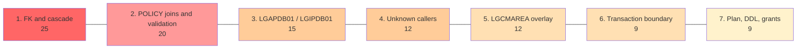

# Claims Separation — Migration Hotspots (Ranked)

**Builds on:** [IMPACT-ANALYSIS.md](IMPACT-ANALYSIS.md) · [Claims domain](../../architecture/claims-domain.md)
**Target design (as before):** Claims moves to a separate service with its own database. It validates policies through a mainframe policy API or MQ service. The foreign key is replaced by an application check.
**Method:** Local scanner database (statement and paragraph counts, call graph) plus direct source reading. Z Understand was not used. Scores are my judgement, not measured values.

**Scoring:** Likelihood (L) and Impact (I), each 1–5. Score = L × I. "Failure mode" says whether a miss would show up immediately (**loud**) or only later in the data (**silent**). Silent failures rank above loud ones at equal scores, because they are found late.

---

## 1. Ranked Summary

| Rank | Hotspot | Type | L | I | Score | Failure mode |
|:-:|---|---|:-:|:-:|:-:|---|
| 1 | Policy-to-claim integrity: foreign key and cascade delete | Shared data | 5 | 5 | **25** | **Silent** |
| 2 | Claims reads and writes depend on `POLICY` (joins, no customer column, no existence service) | Shared data / boundary | 5 | 4 | **20** | Loud on read, silent on write |
| 3 | Shared router programs `LGAPDB01` and `LGIPDB01` | Shared modules / coupled programs | 3 | 5 | **15** | Loud |
| 4 | Unknown callers of the claim request IDs and screen | Boundary | 3 | 4 | **12** | Loud |
| 5 | `LGCMAREA` COMMAREA overlay, included by 11 programs | Shared data contract | 3 | 4 | **12** | Loud (compile) |
| 6 | Transaction boundary and validate-then-insert race | Boundary | 3 | 3 | **9** | **Silent** |
| 7 | Shared Db2 plan, DDL job and `PUBLIC` grants | Shared infrastructure | 3 | 3 | **9** | Loud |

Ranks 4 and 5 tie at 12. Rank 4 is higher because static analysis cannot close it, while rank 5 is fully visible and can be deferred.

---

## 2. What the Measurements Show

| Measure | Result | Meaning |
|---|---|---|
| Columns linking `CLAIM` to other tables | **1** (`PolicyNumber`), see [`db2cre.jcl:353`](../../../DDL/db2cre.jcl:353) | The data boundary is narrow. `CLAIM` has no customer column, so every customer-level lookup goes through `POLICY` |
| `CLAIM` tablespace | Its own, `GENATS07` | The table can be unloaded and dropped without touching other tables |
| Claim statements in `LGAPDB01` | 12 of 218 (about 6%) | Small share of a shared program. Counts exclude routing and declarations, so this is a floor |
| Claim statements in `LGIPDB01` | 70 of 515 (about 14%), in a file of about 1,500 lines, the largest program | Claim removal here is a meaningful edit |
| Programs including `LGCMAREA` | **11 of 12** PL/I programs. Only `LGUPOL01` does not (its include is commented out) | Widest shared structure in the application |
| Programs including `LGPOLICY` | 4 (`LGAPDB01`, `LGIPDB01`, `LGIPOL01`, `LGUPDB01`) | Claim lengths and host structure live here too |
| Claim request IDs unknown to a router | Return code `99` ([`LGAPDB01.pli:223`](../../../PLI%20Programs/LGAPDB01.pli:223), [`LGIPDB01.pli:323`](../../../PLI%20Programs/LGIPDB01.pli:323)) | Missed callers will fail loudly, not silently |

---

## 3. Hotspot Detail

### 1. Policy-to-claim integrity (score 25)
**Where:** [`db2cre.jcl:363`](../../../DDL/db2cre.jcl:363) (`FOREIGN KEY … ON DELETE CASCADE`), [`LGDPDB01.pli:149`](../../../PLI%20Programs/LGDPDB01.pli:149) (the only delete), [`db2cre.jcl:167`](../../../DDL/db2cre.jcl:167) (customer → policy cascade).

**Why it matters**
- `LGDPDB01` never names `CLAIM`. Claims are deleted purely as a Db2 side effect. Moving the table removes that behaviour without any code change to show it.
- The same chain runs one level up. Deleting a customer deletes policies and then claims. The customer programs are not in the workspace, so I cannot see or change that path.
- It is silent. Orphaned claims cause no error. They build up and show wrong results later.
- There is no replacement in the code. No event, queue or notification mechanism exists today. The workspace has no MQ calls.

**What to do:** decide the business rule (delete, archive or keep claims for deleted policies). Add a policy-deleted notice in `LGDPDB01`. Find the customer-delete path. Plan a periodic orphan check.

### 2. Claims depend on `POLICY` for reads and writes (score 20)
**Where:** [`LGIPDB01.pli:160`](../../../PLI%20Programs/LGIPDB01.pli:160) and [`:1096`](../../../PLI%20Programs/LGIPDB01.pli:1096) (joins), [`LGAPDB01.pli:146`](../../../PLI%20Programs/LGAPDB01.pli:146) (policy number taken straight from the request).

**Why it matters**
- **Customer search breaks on day one.** `CusClaim_Cursor` finds a customer's claims by joining `POLICY.CustomerNumber`. With claims in another database the join is impossible. The new service must store the customer number itself and backfill every existing row.
- **No usable existence check exists.** The only policy-number-only lookup is [`02ICOM`](../../../PLI%20Programs/LGIPDB01.pli:774), and it joins `COMMERCIAL`, so it finds Commercial policies only. The other lookups also need the customer number and the policy type. A new `POLICY`-only service is required.
- **The write side is silent.** Today a claim for a missing policy is rejected by Db2. The new check must reproduce that, or invalid claims will be stored.

### 3. Shared router programs `LGAPDB01` and `LGIPDB01` (score 15)
**Where:** claim branches at [`LGAPDB01.pli:174`](../../../PLI%20Programs/LGAPDB01.pli:174), [`:195`](../../../PLI%20Programs/LGAPDB01.pli:195), [`:219`](../../../PLI%20Programs/LGAPDB01.pli:219) and [`LGIPDB01.pli:314`](../../../PLI%20Programs/LGIPDB01.pli:314).

**Why it matters**
- Each program serves every policy type and ships as one load module and one Db2 package, so you cannot change the claim part alone.
- The claim code is mixed into shared declarations: `DB2_IN_INTEGERS` in `LGAPDB01`, and the request-ID router, cursor declarations and host variables in `LGIPDB01`.
- A mistake here breaks add or inquire for Endowment, House, Motor and Commercial policies, which are the core business flows.
- `LGIPDB01` is the largest and most complex program (about 1,500 lines). Edits there carry the most regression risk.

**What to do:** remove claim code in its own release. Run full add and inquire regression for every policy type. Compare access paths after the rebind.

### 4. Unknown callers (score 12)
**Where:** screen `SSMAPP5` ([`SSMAP.bms:616`](../../../Maps/SSMAP.bms:616)). The CSD defines only `SSP1`–`SSP4`. `LGTESTP2`–`4`, `LGIPVS01` and the customer programs have no source here.

**Why it matters**
- I found no program that sends `01ACLM`, `01ICLM` or `02ICLM`, but about half the defined application is missing. Absence of evidence is not proof.
- Failure would be loud (return code `99`), which helps. The risk is finding callers in production instead of before cutover.
- A search of the full source repository and the CICS transaction logs is the cheap way to close this.

### 5. `LGCMAREA` overlay (score 12)
**Where:** [`LGCMAREA.inc:102`](../../../Includes/LGCMAREA.inc:102). `CA_CLAIM` is one of several layouts over the same 32,400-byte `CA_POLICY_SPECIFIC` area, alongside Endowment, House, Motor and Commercial.

**Why it matters**
- 11 of 12 programs include it. Editing it forces a recompile of nearly everything.
- Its cleanup is not urgent. Leaving `CA_CLAIM` in place breaks nothing, so the lowest-risk choice is to remove it **last**.
- Shared policy code reads these bytes under other names. For example, [`LGIPOL01.pli:96`](../../../PLI%20Programs/LGIPOL01.pli:96) tests `CA_M_MAKE` after every inquiry, including claim inquiries, because the Motor field overlays the start of the claim number.
- External callers may rely on the exact byte layout. Any consumer outside this workspace is unknown.

### 6. Transaction boundary and validate-then-insert race (score 9)
**Where:** [`LGAPDB01.pli:567`](../../../PLI%20Programs/LGAPDB01.pli:567) (`ABEND LGSQ` to back out), [`LGAPDB01.pli:229`](../../../PLI%20Programs/LGAPDB01.pli:229) (link to the VSAM writer).

**Why it matters**
- Today the foreign key checks the policy and inserts the claim in one unit of work. After the move the check and the insert are separate calls, so a policy can be deleted between them.
- CICS backout (`ABEND LGSQ`) does not reach the new database. The new service needs its own idempotency and compensation.
- This is the usual price of splitting a database. It is medium impact because the hotspot 1 reconciliation also catches these cases.

### 7. Shared Db2 plan, DDL job and grants (score 9)
**Where:** [`db2cre.jcl:353`](../../../DDL/db2cre.jcl:353) (create), [`:400`](../../../DDL/db2cre.jcl:400) (`GRANT ALL … TO PUBLIC`).

**Why it matters**
- Claim SQL is bound into the same packages as the policy SQL, so the claim code must be gone before the table is dropped.
- One DDL job creates every table. It must be split, and the drop must come last.
- `PUBLIC` access on claim data does not carry over safely. The new platform needs real access control.
- Ranked low because it is visible, well understood and handled by ordinary release steps.

---

## 4. Lower-Ranked Items

| Item | Why it is lower | Note |
|---|---|---|
| Claim add also writes `KSDSPOLY` ([`LGAPVS01.pli:84`](../../../PLI%20Programs/LGAPVS01.pli:84)) | Probably an unintended side effect, so removal is likely a fix | Check the file for claim-created records and for readers such as `LGIPVS01` (no source here) |
| `LGSTSQ` error logging | Easy to replace | Logging gap, not a functional one |
| `LGUPOL01` passes `01UCLM` on after setting `99` ([`:128`](../../../PLI%20Programs/LGUPOL01.pli:128)) | Claim update was never supported | Make the rejection explicit during cleanup |
| Claim number never set before insert ([`LGAPDB01.pli:556`](../../../PLI%20Programs/LGAPDB01.pli:556)) | A defect to fix, not a coupling | Profile production data before choosing the new numbering start |

---

## 5. Suggested Order of Attack

1. **Close the unknowns first** (hotspot 4): search the full repository and logs for claim request IDs and `SSMAPP5`.
2. **Design the integrity replacement** (hotspots 1 and 2): business rule for deletes, the policy-check service, and the customer-number backfill.
3. **Move data and traffic** behind a switch, reads before writes (hotspots 2 and 6).
4. **Remove claim code** from `LGAPDB01` and `LGIPDB01` in a separate release (hotspot 3).
5. **Clean up last:** `LGCMAREA`, `LGPOLICY`, the DDL job, grants and plan (hotspots 5 and 7).
